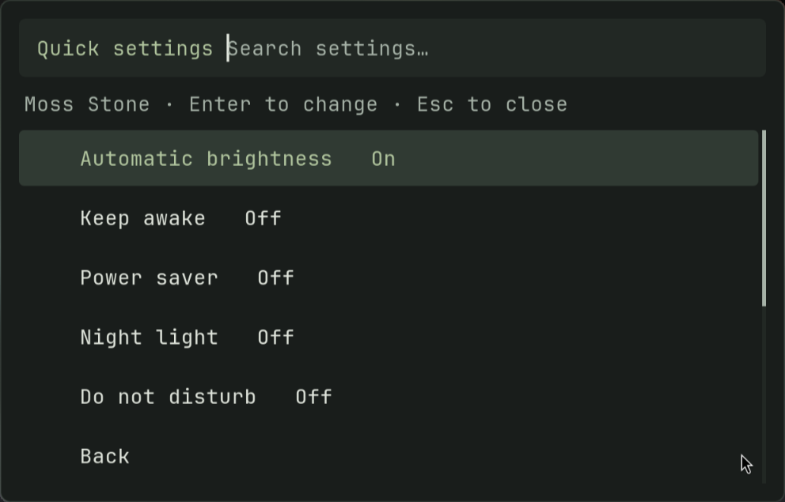
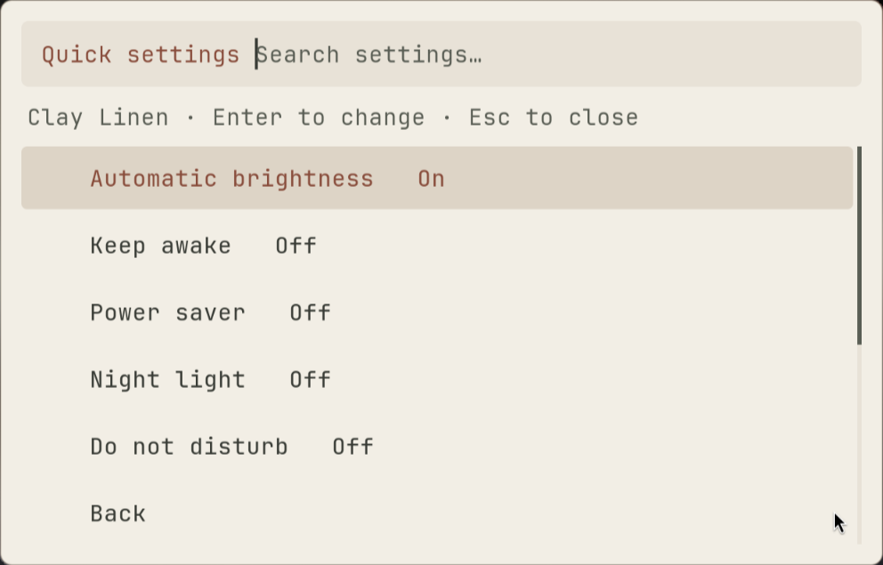
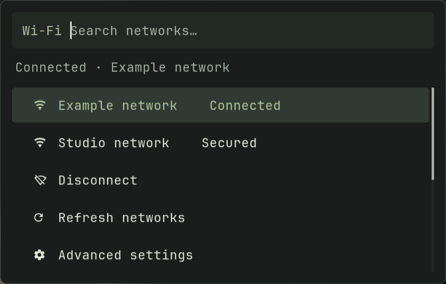
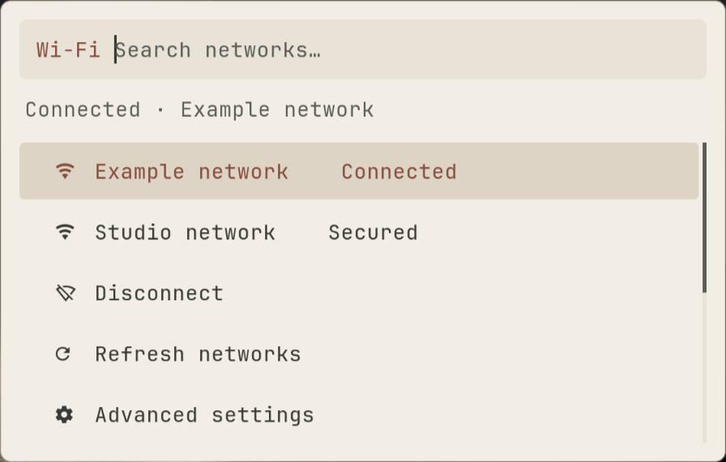
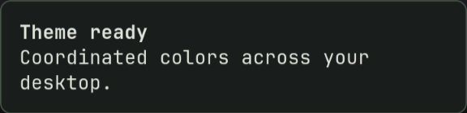
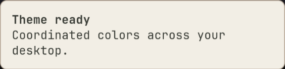
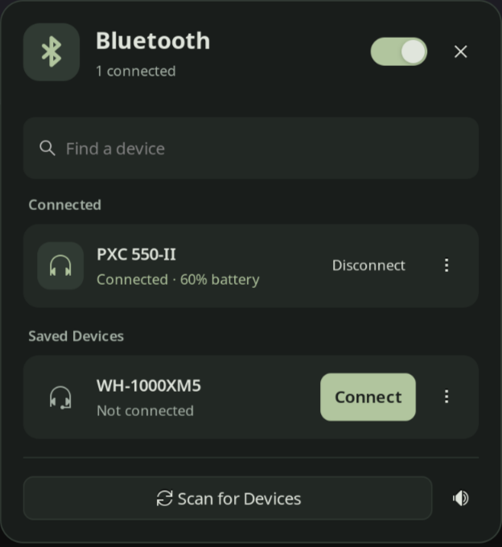
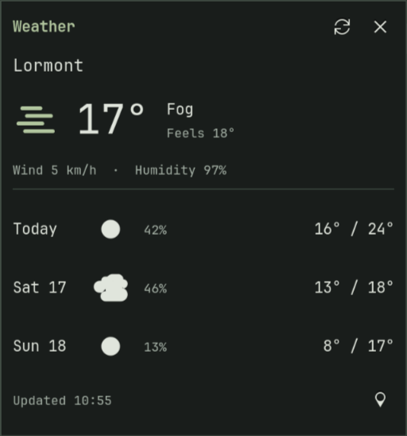
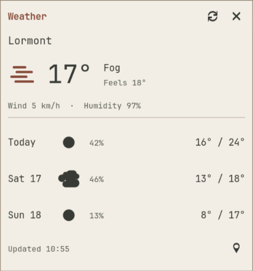

# Desktop polish

The September 2026 pass brings quieter surfaces, clearer menu navigation, and more reliable feedback to the existing Hyprland, Waybar, and Rofi desktop. Omarchy informed the menu hierarchy, grouped bar controls, and contextual indicators. The [source review](ui_ux_research.md) records the references and initial findings.

## Appearance and interaction

- The bar uses two grouped surfaces, consistent spacing, and subdued ordinary states. Recording, Do Not Disturb, and keep-awake indicators appear when relevant. Tooltips explain click and scroll actions.
- Menus have opaque backgrounds, readable selection colors, contextual search prompts, and Back entries. The main menu fits all eleven sections. Quick settings show current states and refresh after a toggle; Escape closes without action.
- Themes coordinate notifications, volume/brightness feedback, screenshot selection, and screen locking. OSDs show a percentage or mute state, replace earlier feedback, stay out of notification history, and remain visible during Do Not Disturb.
- All seven palettes pass the tested 4.5:1 semantic text contrast pairs. The four newer themes retain their existing high-contrast terminal palettes. Theme changes reload running Kitty windows.
- Theme and wallpaper pickers show readable names and wallpaper thumbnails. Existing window gaps, monitor scaling, and notch clearance are preserved; disabling and restoring gaps returns their observed dimensions.

| Dark: Moss Stone | Light: Clay Linen |
|---|---|
|  |  |
|  |  |
|  |  |
|  |  |

These are native rendered panels; quick-setting rows, device names, and notification contents are fixtures. The [main menu preview](screenshots/ui-polish/main-menu.png) shows the installed menu.

## Behavior fixes

Recording controls no longer stop a recording merely by opening. Startup checks confirm the recorder survives; stopping verifies process identity, waits for finalization, and checks the output before reporting success. A visible bar indicator links back to recording controls. The local recorder's incompatible FFmpeg libraries were repaired with Fedora's native ARM64 `wf-recorder` 0.6.0 binary; its installer now validates library resolution before replacing a working executable.

Reminder cleanup stops the actual timer and service, reports failures, and accepts decimal durations such as `08`. Clipboard menus exclude watcher state. Unlisted menu input cannot trigger an action, and cancelled power confirmations do nothing. Update checks distinguish failure from an up-to-date system; offline weather has a clean empty state. Agent diagnostics remain visible in their terminal.

## Install and recovery

```bash
python3 scripts/install-ui-polish.py          # Preview and check for local edits
python3 scripts/install-ui-polish.py --apply  # Back up, install, preserve active theme
```

The installer manages an explicit file manifest. It stops before writing if a destination has unrecognized edits, backs up existing and generated files under `~/.local/state/custom-linux-backups/ui-polish-*`, then regenerates the current theme. `previously-absent.json` records files that did not exist before installation. Review the relevant backup before restoring files, then run `obsidian-theme restore` to regenerate their theme outputs.

The initial backup for this pass is `ui-polish-20260905_130346_994267`; subsequent backups hold intermediate refinements. The separate recorder backup is `recorder-repair-20260905_130347/wf-recorder`. Binary repair is not part of the UI installer; `obsidian-install-wf-recorder` provides the validated native-package extraction route when needed.

The live desktop remains on **Moss Stone**. The portable snapshot retains **Obsidian Ember** as its saved default, rendered from the same updated templates.

## Verification

```bash
python3 scripts/test-desktop-ui.py
python3 scripts/test-minimal-themes.py
./scripts/test-agent-integration.sh
./scripts/test-bluetooth-integration.sh
./scripts/verify-snapshot.sh
```

Interaction tests use an isolated home and mocked power, audio, notification, and service commands. They cover selection, Back, Escape, cancelled confirmation, reminder failures, clipboard state, gap restoration, theme-aware lock arguments, recorder startup failure, active status, and verified stopping. All seven themes render through the real switcher.

Native Rofi parsing and dark/light menu, device-panel, notification, and OSD rendering were checked on the desktop. A three-second silent capture of a small bar region produced a valid H.264 video. Microphone recording, real locking/suspending, package upgrades, and connectivity changes were not executed during verification.

## Native Bluetooth panel

The Bluetooth bar icon opens a compact GTK panel beside the bar. It reads the active desktop palette and groups devices into Connected, Saved Devices, and Nearby Devices. Saved devices have a Connect button; nearby devices have a Pair button that also connects after pairing. Battery percentages appear when BlueZ supplies them. Search filters names without changing device state.

BlueZ signals update the panel as devices connect, disconnect, or appear during scanning. An inline spinner shows an operation in progress, and controls that would conflict with it stay disabled. Device details contain the address, PIN pairing when needed, and Forget Device with confirmation. Turning Bluetooth off also requires confirmation while devices are connected. Escape returns from details or closes the main panel; clicking outside or clicking the bar icon again closes it. Dismissing the panel during pairing lets the requested operation finish.



The native panel uses the system Python interpreter with `python3-gobject`, `gtk3`, and `gtk-layer-shell`. The existing Rofi menu remains available as a fallback when the panel files are absent. The CLI connection commands and installed sleep recovery service remain independent of the panel.

```bash
/usr/bin/python3 scripts/test-bluetooth-panel.py
python3 scripts/test-bluetooth-pair-connect.py
/usr/bin/python3 scripts/test-bluetooth-panel.py --live-desktop
```

The optional desktop check opens the real GTK panel with example devices and inert commands. It tests mouse and keyboard dismissal, search, details and Back, connection progress, and cancelling Forget Device. It restores the pointer and does not change Bluetooth connections. The installed panel was also checked against the real PXC 550-II connection and battery state.

The earlier suspend workaround is in `scripts/bluetooth-sleep/`. Installing it requires administrator authentication: `pkexec /usr/bin/bash scripts/bluetooth-sleep/install-system-fix`. It reloads this Mac's BCM4387 Bluetooth driver across sleep and restores previously connected devices. Its driver unload/reload sequence passed a live test; a complete suspend/resume cycle has not been tested.

## Wi-Fi and fallback Bluetooth mouse dismissal

Both bar dropdowns close when clicking outside them or clicking their bar icon again. Rows activate with one mouse click; clicking the search entry keeps the menu open, and Escape still cancels. Bluetooth status queries now return immediately after completing, while an external timeout still bounds hung commands. The disabled-state tooltips describe the menu that actually opens.

Rofi 2.0 advertises `-click-to-exit`, but its [release notes](https://github.com/davatorium/rofi/releases/tag/2.0.0) document that it does not work on Wayland. The shared device theme therefore uses a transparent fullscreen surface with cancellation buttons around a compact panel. This follows the same surface-capture principle as [upstream's later Wayland fix](https://github.com/davatorium/rofi/pull/2272), using [Rofi's supported button actions](https://davatorium.github.io/rofi/current/rofi-theme.5/#button). Each wrapper supplies the initial row count because Rofi 2.0 does not resize the nested list naturally in this layout. The surface covers the current display and consumes the dismissing click.

Run the optional native interaction check while the desktop is idle:

```bash
python3 scripts/test-connectivity-ui.py --live-desktop
```

It opens example panels through the Wi-Fi helper and fallback Bluetooth Rofi menu, injects pointer and keyboard events through Wayland, and restores the pointer afterward. Network, Bluetooth, notification, and settings commands are mocked. Sixteen checks cover all four outside regions, inside search and single-click selection, Escape, keyboard selection, and repeat-icon dismissal; they also check that cancellation does not toggle either radio. The old theme fails the outside-click assertion. The real bar icons were additionally checked twice per dismissal method: each opened in approximately 0.2 seconds. Connections and pairings were not changed during those earlier checks.

The live installation backup for this fix is `~/.local/state/custom-linux-backups/ui-polish-20260905_134714_008814`.

## Default control-panel style (October 2026)

The accepted Power panel establishes the desktop control style: monospace text,
square corners, a one-pixel border, flat rows, compact spacing, and an accent
highlight for the active choice. Avoid raised cards, large badges, and repeated
helper text. Put secondary battery and CPU information in tooltips. Keep task
controls, progress, errors, and connection confirmations visible when needed.

Power and Bluetooth share `dotfiles/.config/obsidian-ember/panel.css`; each has a
small component stylesheet for its own layout. Both resolve colours from the
selected palette when opened. Wi-Fi and its password prompts use the compact
`rofi/network.rasi`. The main Rofi launcher, Waybar, and the Mako template follow
the same flat geometry. Changing palettes keeps this design.

The October backup is `~/.local/state/custom-linux-backups/flat-ui-20261014/`.
The installer manifest includes the shared stylesheet and Power panel so a
reinstall carries the complete design. Existing pairing, network selection,
and power-policy backends remain in use.

Validation: all seven palette/rendering checks, Bluetooth backend tests, native
Bluetooth pointer/keyboard checks, and Wi-Fi/fallback menu dismissal, search,
selection, and repeated-icon checks passed. Power row selection, busy state,
and error recovery were tested with a simulated backend. No radio connection
or CPU mode was changed by these UI tests.

[Bluetooth preview](screenshots/flat-ui/bluetooth.png) and
[Wi-Fi preview](screenshots/flat-ui/wifi.png) use example devices and networks.

## Weather panel

Weather now uses the shared compact panel style: a 320-pixel surface, square border, current palette, monospace labels, and quiet icon controls. It opens on the built-in display below the bar. Click the weather indicator, choose Weather in the menu, or use Super+Ctrl+Alt+W. Escape, an outside click, and repeated activation close the panel; Escape first closes the location editor when it is open.

The summary shows Celsius temperature, conditions, feels-like temperature, wind, and humidity. Three forecast rows show midday conditions, the highest rain chance among that day's forecast intervals, and daily low/high temperatures. Tooltips explain the columns. Refresh retrieves new data; the location button reveals a city field, with blank meaning automatic network-based location. Automatic location remains enabled on the installed desktop.

The panel and bar share [wttr.in's JSON service](https://github.com/chubin/wttr.in#json-output). The cache refreshes after 30 minutes, remains available for up to six hours when offline, and is separated by location. Offline data is labeled; expired or missing data produces a retryable empty state. The footer timestamp is the retrieval time, with observation time in its tooltip. The unavailable bar indicator remains clickable. No API key is required.

| Moss Stone | Clay Linen |
|---|---|
|  |  |

These screenshots use a retrieved automatic-location response, rendered in both palettes. Native checks passed for refresh, location editing with isolated settings, offline and empty states, panel width, Escape, outside click, and repeated activation. CSS parsed in all seven palettes; the existing desktop regression suite also passed.

```bash
/usr/bin/python3 scripts/test-weather.py
/usr/bin/python3 scripts/test-weather-ui.py --live-desktop
```

Files are included in the desktop installer manifest. The original live weather integration is backed up at `~/.local/state/custom-linux-backups/weather-20261016_105341`, with new files listed in `previously-absent.json`. Location preferences live at `~/.config/obsidian-ember/weather.json`; responses are cached under `~/.cache/obsidian-weather`.
